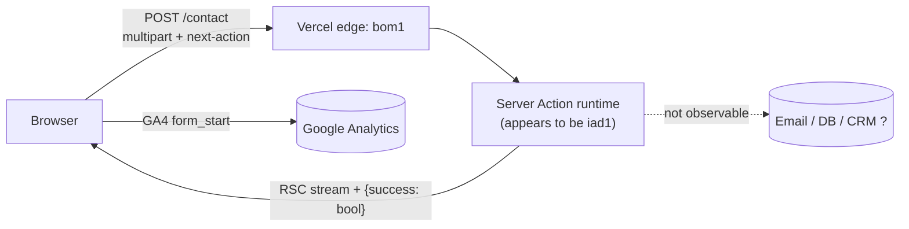

# Backend Technical Audit Report — cynbit.in

## 1. Scope and method
Passive observation of the public site through Chrome DevTools on 21 Oct 2026 (response `Date` headers 09:34–09:49 GMT). Only pages and requests produced by ordinary use were examined. The contact form was submitted a few times with dummy data. See `README.md` for the rules followed and `evidence/EVIDENCE_LOG.md` for every observation.

## 2. Observed architecture

| Layer | What was observed | Status |
|---|---|---|
| Hosting / CDN | `server: Vercel`, `x-vercel-id`, `x-vercel-cache: BYPASS` | Confirmed |
| Framework | Next.js App Router with Server Actions (`next-action` header, `text/x-component`, route group `(marketing)`) | Confirmed |
| Transport | HTTPS, HSTS 2 years, Brotli (`content-encoding: br`) | Confirmed |
| Analytics | GA4 via a `GoogleAnalytics` component; `form_start` events | Confirmed |
| Persistence / email delivery | Not observable from the browser | Unknown |
| Authentication | No login or session cookie seen on the pages inspected (only `_ga*`) | Not assessed beyond this |

## 3. API contract of the one backend interaction observed
| Item | Observation |
|---|---|
| Route | `POST https://www.cynbit.in/contact` (same origin) |
| Mechanism | Next.js Server Action, identified by the `next-action` request header |
| Request | `multipart/form-data`; 763 and 699 bytes in two submissions; the form has 6 fields (from GA metadata). Field names not captured (P-2). |
| Response | `200`, `text/x-component`; body ends `1:{"success":true}`. A failure case returned `1:{"success":false}` |
| Caching | `no-cache, no-store, max-age=0, must-revalidate`, appropriate for a mutation |
| CORS | No `Access-Control-*` headers on the response; same-origin use only |
| Error structure | No codes or field errors seen (F-01) |

## 4. Summary of findings
Seven findings, none above Low–Medium (potential), none demonstrated as exploitable. Full detail in `findings/FINDINGS.md`: F-01 opaque result contract, F-02 partial validation signal, F-03 hardening headers, F-04 abuse controls (hypothesis), F-05 function region, F-06 render-tree payload, F-07 third-party tracking.

## 5. What looks good
- HTTPS everywhere with a two-year HSTS policy.
- Mutation responses are not cacheable.
- Compression is enabled.
- No application cookies beyond analytics on the pages inspected, which keeps the attack surface small.
- Same-origin submission with no permissive CORS headers on the captured response.

## 6. Recommended improvements (summary)
1. Structured validation/error responses (`ProblemDetail`, 422, correlation ID).
2. Server-side validation as the source of truth; the browser check is only convenience.
3. Rate limiting + honeypot (+ optional CAPTCHA) on the form endpoint.
4. Hardening headers via `next.config.js`; CSP in report-only first.
5. Move the function region next to users/dependencies.
6. Revisit analytics consent and font self-hosting.

Code: `recommendations/nextjs-equivalents.md` (observed stack) and `recommendations/spring-boot-reference/` (Java 21, Spring Boot).

## 7. Limitations (not assessed)
Authentication flows, the Careers/BitElevate pages and the candidate portal, TLS configuration, DNS/email security (SPF/DKIM/DMARC), `robots.txt` / `sitemap.xml` / `security.txt`, 404 behaviour, `GET /` document headers, quantified performance (P-1 to P-8). Nothing about these is claimed.
